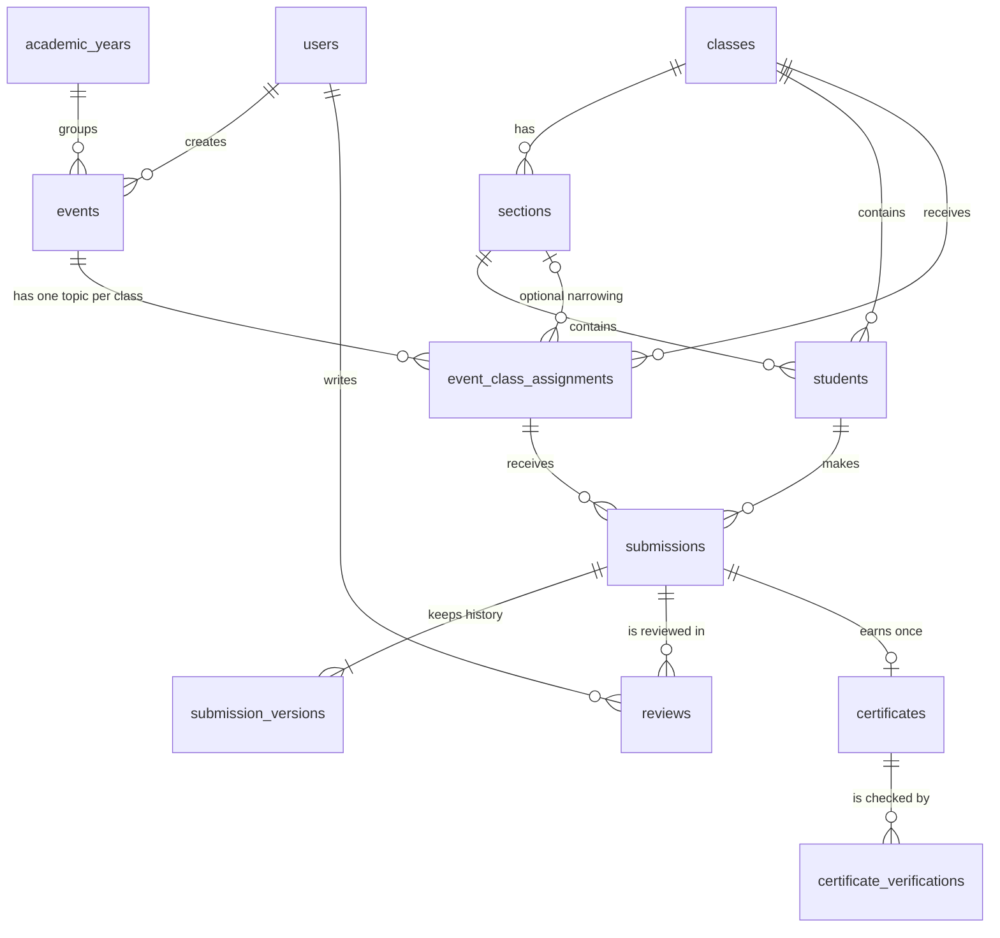

# Database design

The application uses **SQLite**: the whole database is one file, `data/school_events.db`, created and upgraded automatically.
Nothing in this document needs to be done by hand - it only explains what is stored where.

## Entity relationship diagram



The same picture in plain text:

```
academic_years --< events >-- users(teacher)
                     |
                     +--< event_class_assignments >-- classes --< sections
                                   |                      |            |
                                   |                      +--< students >+
                                   |                              |
                                   +------< submissions >---------+
                                              |   |   \
                       submission_versions <--+   |    +--> certificates --< certificate_verifications
                                                  +--< reviews >-- users(teacher)
```

## Tables

### `academic_years`

School years such as 2026-27. Events belong to one academic year.

**Primary key:** `id`

**Unique rules:** `sqlite_autoindex_academic_years_1` on (name)

| Column | Type | Required | Default |
|---|---|---|---|
| `id` | INTEGER | yes |  |
| `name` | TEXT | yes |  |
| `start_date` | TEXT | no |  |
| `end_date` | TEXT | no |  |
| `is_active` | INTEGER | yes | 1 |

### `application_settings`

Settings changed on the Settings page (school name, logo, colours, upload limit, backups ...).

**Primary key:** `key`

**Foreign keys:** `updated_by` -> `users.id` (on delete set null)

**Unique rules:** `sqlite_autoindex_application_settings_1` on (key)

| Column | Type | Required | Default |
|---|---|---|---|
| `key` | TEXT | yes |  |
| `value` | TEXT | yes | '' |
| `updated_at` | TEXT | yes |  |
| `updated_by` | INTEGER | no |  |

### `audit_logs`

General activity log: logins, failed logins, account changes, event changes, reviews.

**Primary key:** `id`

**Indexes (for speed):** `ix_audit_created` on (created_at)

| Column | Type | Required | Default |
|---|---|---|---|
| `id` | INTEGER | yes |  |
| `actor_role` | TEXT | no |  |
| `actor_id` | INTEGER | no |  |
| `action` | TEXT | yes |  |
| `entity` | TEXT | no |  |
| `entity_id` | TEXT | no |  |
| `details` | TEXT | no |  |
| `created_at` | TEXT | yes |  |

### `certificate_verifications`

A log of each time someone looked a certificate up on the public verification page.

**Primary key:** `id`

**Foreign keys:** `certificate_id` -> `certificates.id` (on delete set null)

**Indexes (for speed):** `ix_verif_cert` on (certificate_id)

| Column | Type | Required | Default |
|---|---|---|---|
| `id` | INTEGER | yes |  |
| `certificate_id` | INTEGER | no |  |
| `query_text` | TEXT | no |  |
| `result` | TEXT | yes |  |
| `verified_at` | TEXT | yes |  |

### `certificates`

Issued certificates. Stores a snapshot of the names/topic so a certificate never changes later.

**Primary key:** `id`

**Foreign keys:** `teacher_id` -> `users.id` (on delete set null); `event_id` -> `events.id` (on delete restrict); `student_id` -> `students.id` (on delete restrict); `submission_id` -> `submissions.id` (on delete restrict)

**Unique rules:** `sqlite_autoindex_certificates_3` on (submission_id); `sqlite_autoindex_certificates_2` on (verification_token); `sqlite_autoindex_certificates_1` on (certificate_code)

**Indexes (for speed):** `ix_cert_event` on (event_id); `ix_cert_student` on (student_id)

| Column | Type | Required | Default |
|---|---|---|---|
| `id` | INTEGER | yes |  |
| `certificate_code` | TEXT | yes |  |
| `verification_token` | TEXT | yes |  |
| `submission_id` | INTEGER | yes |  |
| `student_id` | INTEGER | yes |  |
| `event_id` | INTEGER | yes |  |
| `student_name` | TEXT | yes |  |
| `class_name` | TEXT | yes |  |
| `section_name` | TEXT | yes |  |
| `roll_number` | TEXT | yes |  |
| `event_name` | TEXT | yes |  |
| `topic` | TEXT | yes |  |
| `cert_type` | TEXT | yes |  |
| `remark` | TEXT | yes | '' |
| `school_name` | TEXT | yes |  |
| `principal_name` | TEXT | yes | '' |
| `teacher_name` | TEXT | yes | '' |
| `teacher_designation` | TEXT | yes | '' |
| `teacher_id` | INTEGER | no |  |
| `issued_on` | TEXT | yes |  |
| `status` | TEXT | yes | 'valid' |
| `revoked_reason` | TEXT | no |  |
| `revoked_at` | TEXT | no |  |
| `file_path` | TEXT | yes |  |
| `file_sha256` | TEXT | no |  |
| `regenerated_count` | INTEGER | yes | 0 |
| `generated_by_role` | TEXT | no |  |
| `generated_by_id` | INTEGER | no |  |
| `created_at` | TEXT | yes |  |

### `classes`

Classes (6, 7, 8 ... or any name). Added and edited in the app, never hard-coded.

**Primary key:** `id`

**Unique rules:** `sqlite_autoindex_classes_1` on (name)

| Column | Type | Required | Default |
|---|---|---|---|
| `id` | INTEGER | yes |  |
| `name` | TEXT | yes |  |
| `sort_order` | INTEGER | yes | 1000 |
| `is_active` | INTEGER | yes | 1 |

### `database_migrations`

Which database upgrades have been applied (this is how updates keep your data).

**Primary key:** `version`

| Column | Type | Required | Default |
|---|---|---|---|
| `version` | INTEGER | yes |  |
| `name` | TEXT | yes |  |
| `applied_at` | TEXT | yes |  |

### `event_class_assignments`

THE class-specific part: one row per class (or class + section) holding its own topic, instructions, formats, deadline, criteria and marks.

**Primary key:** `id`

**Foreign keys:** `section_id` -> `sections.id` (on delete restrict); `class_id` -> `classes.id` (on delete restrict); `event_id` -> `events.id` (on delete cascade)

**Unique rules:** `ux_assignment_scope` on (event_id, class_id, (expression))

**Indexes (for speed):** `ix_assign_class` on (class_id, section_id); `ix_assign_event` on (event_id)

| Column | Type | Required | Default |
|---|---|---|---|
| `id` | INTEGER | yes |  |
| `event_id` | INTEGER | yes |  |
| `class_id` | INTEGER | yes |  |
| `section_id` | INTEGER | no |  |
| `topic` | TEXT | yes |  |
| `description` | TEXT | yes | '' |
| `instructions` | TEXT | yes | '' |
| `allowed_formats` | TEXT | yes | 'pdf,docx,pptx,jpg,jpeg,png' |
| `deadline` | TEXT | no |  |
| `criteria` | TEXT | yes | '' |
| `max_marks` | REAL | no |  |
| `reference_path` | TEXT | no |  |
| `reference_name` | TEXT | no |  |
| `created_at` | TEXT | yes |  |
| `updated_at` | TEXT | yes |  |

### `events`

A school event: dates, description, status (draft / published / closed / archived) and owner teacher.

**Primary key:** `id`

**Foreign keys:** `created_by` -> `users.id` (on delete restrict); `academic_year_id` -> `academic_years.id` (on delete restrict)

**Indexes (for speed):** `ix_events_creator` on (created_by); `ix_events_status` on (status)

| Column | Type | Required | Default |
|---|---|---|---|
| `id` | INTEGER | yes |  |
| `name` | TEXT | yes |  |
| `description` | TEXT | yes | '' |
| `category` | TEXT | yes | 'General' |
| `poster_path` | TEXT | no |  |
| `event_date` | TEXT | no |  |
| `opens_on` | TEXT | yes |  |
| `deadline` | TEXT | yes |  |
| `instructions` | TEXT | yes | '' |
| `academic_year_id` | INTEGER | yes |  |
| `status` | TEXT | yes | 'draft' |
| `created_by` | INTEGER | yes |  |
| `created_at` | TEXT | yes |  |
| `updated_at` | TEXT | yes |  |

### `reviews`

The audit trail of teacher decisions: reviewer, action, feedback, previous status, new status, time.

**Primary key:** `id`

**Foreign keys:** `reviewer_id` -> `users.id` (on delete restrict); `version_id` -> `submission_versions.id` (on delete restrict); `submission_id` -> `submissions.id` (on delete restrict)

**Indexes (for speed):** `ix_rev_sub` on (submission_id)

| Column | Type | Required | Default |
|---|---|---|---|
| `id` | INTEGER | yes |  |
| `submission_id` | INTEGER | yes |  |
| `version_id` | INTEGER | no |  |
| `reviewer_id` | INTEGER | yes |  |
| `action` | TEXT | yes |  |
| `feedback` | TEXT | yes | '' |
| `previous_status` | TEXT | yes |  |
| `new_status` | TEXT | yes |  |
| `marks` | REAL | no |  |
| `created_at` | TEXT | yes |  |

### `sections`

Sections (A, B ...) that belong to a class.

**Primary key:** `id`

**Foreign keys:** `class_id` -> `classes.id` (on delete restrict)

**Unique rules:** `sqlite_autoindex_sections_1` on (class_id, name)

**Indexes (for speed):** `ix_sections_class` on (class_id)

| Column | Type | Required | Default |
|---|---|---|---|
| `id` | INTEGER | yes |  |
| `class_id` | INTEGER | yes |  |
| `name` | TEXT | yes |  |
| `is_active` | INTEGER | yes | 1 |

### `students`

Student records. A student is identified by class + section + roll number (the name is a second check at login).

**Primary key:** `id`

**Foreign keys:** `created_by` -> `users.id` (on delete set null); `section_id` -> `sections.id` (on delete restrict); `class_id` -> `classes.id` (on delete restrict)

**Unique rules:** `ux_students_identity` on (class_id, section_id, roll_number) (only for active rows)

**Indexes (for speed):** `ix_students_class` on (class_id, section_id)

| Column | Type | Required | Default |
|---|---|---|---|
| `id` | INTEGER | yes |  |
| `full_name` | TEXT | yes |  |
| `class_id` | INTEGER | yes |  |
| `section_id` | INTEGER | yes |  |
| `roll_number` | TEXT | yes |  |
| `is_active` | INTEGER | yes | 1 |
| `created_at` | TEXT | yes |  |
| `created_by` | INTEGER | no |  |

### `submission_versions`

Every uploaded file (version 1, 2, 3 ...). Old versions are never overwritten.

**Primary key:** `id`

**Foreign keys:** `submission_id` -> `submissions.id` (on delete restrict)

**Unique rules:** `sqlite_autoindex_submission_versions_1` on (submission_id, version_no)

**Indexes (for speed):** `ix_ver_sub` on (submission_id)

| Column | Type | Required | Default |
|---|---|---|---|
| `id` | INTEGER | yes |  |
| `submission_id` | INTEGER | yes |  |
| `version_no` | INTEGER | yes |  |
| `original_filename` | TEXT | yes |  |
| `stored_path` | TEXT | yes |  |
| `file_size` | INTEGER | yes |  |
| `sha256` | TEXT | yes |  |
| `uploaded_at` | TEXT | yes |  |

### `submissions`

One row per student per assignment: the current status of that student's work.

**Primary key:** `id`

**Foreign keys:** `last_reviewed_by` -> `users.id` (on delete no action); `student_id` -> `students.id` (on delete restrict); `assignment_id` -> `event_class_assignments.id` (on delete restrict)

**Unique rules:** `sqlite_autoindex_submissions_1` on (assignment_id, student_id)

**Indexes (for speed):** `ix_sub_assignment` on (assignment_id, status); `ix_sub_student` on (student_id); `ix_sub_status` on (status)

| Column | Type | Required | Default |
|---|---|---|---|
| `id` | INTEGER | yes |  |
| `assignment_id` | INTEGER | yes |  |
| `student_id` | INTEGER | yes |  |
| `status` | TEXT | yes |  |
| `current_version` | INTEGER | yes | 1 |
| `marks` | REAL | no |  |
| `cert_type` | TEXT | no |  |
| `cert_remark` | TEXT | no |  |
| `created_at` | TEXT | yes |  |
| `updated_at` | TEXT | yes |  |
| `last_reviewed_by` | INTEGER | no |  |
| `last_reviewed_at` | TEXT | no |  |

### `users`

Teacher and administrator accounts (never students). Passwords are stored only as salted scrypt hashes.

**Primary key:** `id`

**Unique rules:** `sqlite_autoindex_users_1` on (username)

| Column | Type | Required | Default |
|---|---|---|---|
| `id` | INTEGER | yes |  |
| `username` | TEXT | yes |  |
| `password_hash` | TEXT | yes |  |
| `full_name` | TEXT | yes |  |
| `designation` | TEXT | no |  |
| `role` | TEXT | yes |  |
| `is_active` | INTEGER | yes | 1 |
| `failed_attempts` | INTEGER | yes | 0 |
| `locked_until` | TEXT | no |  |
| `signature_path` | TEXT | no |  |
| `created_at` | TEXT | yes |  |
| `last_login_at` | TEXT | no |  |

## How the important rules are enforced

* **Student identity:** `students` has a unique index on class + section + roll number (for active students), so two students can share a name but never a roll number.
* **Different topics for different classes:** `event_class_assignments` has one row per event + class (+ optional section) with its own topic, instructions, formats, deadline and marks. A unique index stops duplicate rows.
* **One submission per student per task, many versions:** `submissions` is unique on (assignment, student); every upload is a new row in `submission_versions`.
* **One certificate per approved submission:** `certificates.submission_id` is unique; `certificate_code` and `verification_token` are unique too.
* **Nothing important is deleted by accident:** most foreign keys use `ON DELETE RESTRICT`; foreign keys are switched on for every connection.
* **Upgrades:** each change to the structure is a numbered migration recorded in `database_migrations`; the application applies missing ones at start-up and makes a safety backup first.
